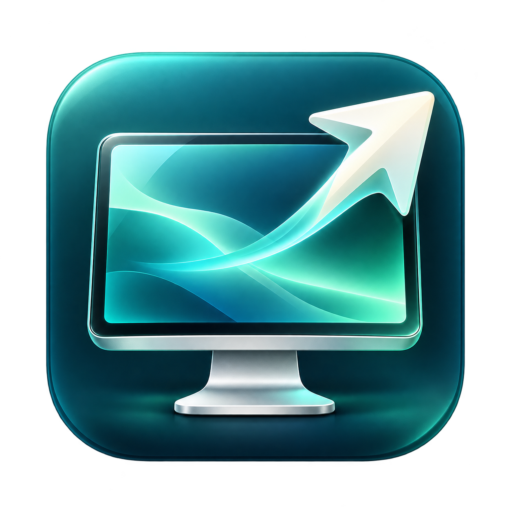

# Remote Launcher

A native macOS launcher for High Performance Screen Sharing. Keep several remote
Macs side by side, connect with one click, and bring the same viewer forward the
next time—even after restarting the launcher.

- Search your saved Macs and choose **Connect** or **Show**.
- Request one or two virtual displays per connection.
- Identify Macs with automatic hardware icons or a manual Mac type choice.
- Open the machine list from the Dock or menu bar.
- Keep settings locally while Screen Sharing handles passwords and Keychain access.

## Requirements

Both Macs need Apple silicon and macOS Sonoma 14 or later. Enable Screen Sharing
or Remote Management on each remote Mac and grant access to the account you use.
The Macs must be able to communicate over UDP ports 5900–5902; a fast wired
network is recommended. See [Apple's High Performance requirements](https://support.apple.com/guide/remote-desktop/use-high-performance-screen-sharing-apdf8e09f5a9/mac).

## Installation

### Homebrew

```sh
brew install --cask hewigovens/tap/remote-launcher
```

To update an existing installation:

```sh
brew upgrade --cask hewigovens/tap/remote-launcher
```

### Download

1. Download the Apple silicon ZIP from [GitHub Releases](https://github.com/hewigovens/remote-launcher/releases/latest).
2. Extract the ZIP and move **Remote Launcher.app** to **Applications**.
3. Open **Remote Launcher** from Applications.

## Get started

1. Choose **Add Mac** and enter a name and host name or IP address. Enter the
   port separately and omit `vnc://`. A username is optional.
2. Choose one or two virtual displays and save.
3. Click the Mac's name or **Connect**, then authenticate in Screen Sharing.
4. Click **Show** to bring an existing viewer forward. Use the row's **…** menu
   to edit or remove its saved entry.

High Performance is the launch default. The footer shows saved-machine and
open-viewer counts; an open viewer does not guarantee an authenticated or
streaming connection. Quitting the launcher or removing a saved entry leaves
Screen Sharing running.

The menu bar lists your saved Macs. Select a Mac to connect or bring its existing
viewer forward, or choose **Open Remote Launcher** to show the main window.

Open **Remote Launcher > Settings…** (⌘,) to turn **Show in menu bar** on or off.
Your choice is saved between launches. The Dock stays available when the menu bar
icon is hidden, and closing the main window leaves the app running.

| Shortcut | Action |
| --- | --- |
| ⌘N | Add a Mac |
| ↑ / ↓ | Select a Mac |
| ⌘Return | Connect or show the selected Mac |
| ⌘I | Edit the selected Mac |

Commands are also available in the File and Connection menus.

### Machine icons

**Mac type: Automatic** detects the hardware model of a saved Mac on the local
network and shows a MacBook, Mac mini, Mac Studio, iMac, or Mac Pro icon.
Last-known models are saved so icons remain available offline.

Allow Local Network access if macOS requests it for automatic icons. Discovery
requires no SSH or password. If discovery is unavailable across a VPN/subnet, or
a model is unknown, choose **Mac type** in the editor to set an icon manually.
Automatic falls back to a generic Mac icon.

## Local data

Saved Macs, preferences, and viewer records are stored locally in:

```text
~/Library/Application Support/dev.hewig.ScreenSharingLauncher/
```

Passwords are never stored by the launcher. Screen Sharing manages authentication
and Keychain access. Invalid machine files are preserved and reported instead of
being overwritten.

## Connection limits

- Connections opened outside the launcher are not adopted.
- Host aliases are separate endpoints; choose one canonical address per Mac.
- Quit a Mac's viewer before reconnecting with changed connection settings.
- Multiple outgoing viewers do not bypass a remote Mac's limit on incoming High
  Performance sessions.

## Contributing

See [CONTRIBUTING.md](CONTRIBUTING.md) for source builds, tests, implementation
notes, signing, packaging, and release verification.
